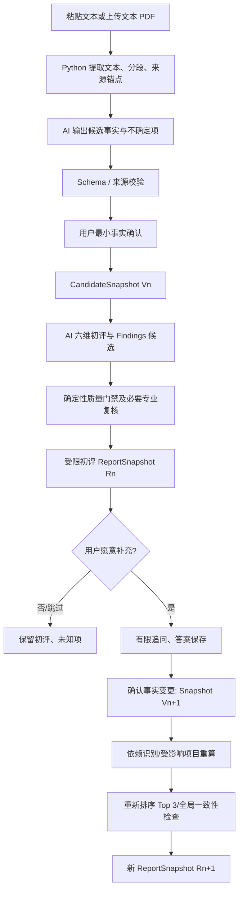

# 知程 AI｜第一批 AI 工作流与数据契约设计 V1.0

> **文档状态**：设计草案／待产品负责人确认，**非开发授权、非 V0 试点上线许可**  
> **日期**：2026-10-14  
> **适用范围**：D0 内部简历初评垂直闭环（含按需追问与项目级增量更新）  
> **产品依据**：`PRD-v1.1.md`，尤其 §4、§6.0、§7、§11–13、§19–20  
> **架构依据**：`知程AI-系统架构方案-V1.0.md`（设计基线，待正式审批）  
> **明确排除**：本文件不实现代码，不确定模型供应商和价格，不替代适用的隐私合规审核。

## 目录

1. [目的、设计状态与边界](#1-目的设计状态与边界)
2. [端到端工作流](#2-端到端工作流)
3. [关键事实确认与动态追问](#3-关键事实确认与动态追问)
4. [核心数据与 Pydantic 候选契约](#4-核心数据与-pydantic-候选契约)
5. [事实依赖与项目级增量更新](#5-事实依赖与项目级增量更新)
6. [快照版本、并发和事务规则](#6-快照版本并发和事务规则)
7. [Worker、Agent 与模型调用契约](#7-workeragent-与模型调用契约)
8. [FastAPI API 与前端显示契约](#8-fastapi-api-与前端显示契约)
9. [质量门禁与可观察性](#9-质量门禁与可观察性)
10. [验收用例与评价方法](#10-验收用例与评价方法)
11. [Codex 实施拆分与执行限制](#11-codex-实施拆分与执行限制)
12. [风险、待决策项与需求追踪](#12-风险待决策项与需求追踪)

---

## 1. 目的、设计状态与边界

### 1.1 要解决的问题

用户只提交一份简历时，产品须先产生**有证据、简洁且可执行的非数值初评**；当关键事实不足时，允许**非强制、少量且与改进有直接关系的追问**；用户补充后**只重新分析受影响项目和维度**，再组装新的完整、一致的反馈快照。

**推荐执行策略**：`最小事实确认 → 第一份初评 → 推荐 1–3 个高价值追问 → 用户可跳过或补充 → 项目级增量重算 → 全局一致性检查 → 新反馈快照`。追问数量为待试验设计参数，而非已验证的最优数字。

### 1.2 需求源与架构建议的边界

| 条目 | 来源性质 | 本文执行解释 |
|---|---|---|
| 上传/解析、确认技能项目贡献后展示初评 | **PRD v1.1 已批准** | 不跳过必要事实确认；见 §4.1、§19 |
| 六维文字初评、V0 不展示 0–100 综合分 | **PRD v1.1 已批准** | 使用 `clear / needs_improvement / unknown / not_applicable` 和来源证据 |
| 正式技术等级、关键短板、项目个人贡献增强等须人工审核 | **PRD v1.1 已批准** | D0 的未审改写仅能作为受限的**内部候选草稿**，不得当作对外正式增强发布 |
| Agent 未来全流程自动审核 | **讨论确定的长期目标** | 当前未获 PRD 授权自动批准或自动发布正式结论 |
| 首批按需追问、项目级增量更新、完整报告快照 | **本轮架构提议** | 需要基于效果、复杂度和验收案例确认 |
| 关系字段 + JSONB、独立 Worker、自有模型网关 | **系统架构候选** | 不是已存在的数据库 DDL 或可运行工程 |

### 1.3 D0 允许与禁止

**D0 允许**：文本粘贴／可提取文字的 PDF、AI 结构化候选、快速事实确认、六维文字初评、原文定位、1–3 个可跳过的事实追问、版本化反馈、经验证的内部改写候选、模型费用与错误监测。

**D0 禁止冒充已实现**：正式 L1–L3 技术授级、岗位匹配百分比、获面/录用概率、全面项目技术认证、未经审核对外发布的项目个人贡献增强、完整 V0 试点及自动 Agent 发布。

目标用户与三岗位族仍以 PRD 规定为准；D0 无目标岗位时**不得强行形成岗位 Gap 或 DEFER**。没有可观察的版式信息时，排版维度必须为 `unknown`。

## 2. 端到端工作流



**固定工作流，而非自主多 Agent 自由循环**。系统编排器分配任务；AI 仅提出结构化候选；后端负责验证、持久化和展示授权。初期通过同一 Python 代码库的独立 API 与 Worker 进程运行。确认事实、回答追问是用户交互中断点，不能由 Agent 自动代答。

### 2.1 各节点的最小输入、输出与失败条件

| 节点 | 输入 | 输出 | 阻断 / 降级 |
|---|---|---|---|
| Parse | 已校验上传/粘贴内容 | 原文、段落、`SourceSpan` | 无文字 PDF → 提示补录，不臆造文字 |
| Extract | 来源片段、受控提示词版本 | `CandidateFactDraft[]`、项目候选 | JSON/来源不合规则重试有限次或等待人工修正 |
| Confirm | 当前提取快照 + 用户操作 | 不可变 `CandidateSnapshot` | 关键贡献未知可以明确留空，不强迫编造 |
| Review | 确认快照 + 必要原文 | `ReviewProposal`（六维、问题、建议） | 排版未知必须 `unknown`；不得授技能等级 |
| Validate | 候选初评 + 已确认事实 + 规则 | 校验问题集 | 虚构贡献/引用失效 → 阻止问题或草稿展示 |
| Clarify | 高价值缺口 + 用户自愿操作 | `ClarificationAnswer` | 跳过/不知道均不作为负面能力证据 |
| Invalidate | 新旧快照与依赖关系 | 受影响项目/维度与无效内容集 | 依赖不明时扩大重算，而非保留过时结论 |
| Rebuild | 有效分析 + 更新分析 | 完整报告候选 | 版本/语义冲突 → 不切换当前可见报告 |

## 3. 关键事实确认与动态追问

### 3.1 确认层与追问层严格分开

- **最小事实确认（初评之前）**：展示提取信息；用户可以纠正关键项目、技能声明及本人贡献。确认表示“用户本人声明/认可”，**不等于技术能力独立验证**。
- **按需追问（初评之后）**：只针对有实际改进价值的缺口，例如“实际负责哪些任务”“性能结论如何验证”。回答生成新的**用户声明**，不直接更新技能等级。
- **不追问或不回答**：允许继续阅读已有初评，相关缺口保留 `unknown`，不无限反复询问。

### 3.2 追问候选及价值门禁

`ClarificationQuestion` 最小包含：`question_id`、`target_project_id`、`trigger_finding_ids`、`missing_fact_fields`、`question`、`expected_use`、`priority`、`status`。

通过的前提：①影响重要结论；②现有来源不能可靠回答；③能由用户合理回答；④与已问问题不重复；⑤未超出本轮预算；⑥无敏感信息过度收集。

首屏**最多推荐 1–3 个候选追问**（待试验参数）；已明确回答、跳过且无新依据的同一事实不重复追问。选择题可作提示，但必须允许自由文本；“没有做过”不是失败答案。

### 3.3 一条例子（示意，不作为用户事实）

原句：“使用 FreeRTOS 实现多任务管理，提高系统实时性。”

初评：该句没有说明个人负责的任务，且“提高实时性”缺少可核查的比较与测试依据。可先建议“说明任务划分及本人动作”；不得虚构具体性能百分比。

追问：“你本人实现了哪些任务？是否实际测量过响应时间或任务延迟？”

补充后：若用户确认负责采集任务与消息队列，更新相关项目表达建议；若用户未测量响应时间，则仍不得宣称“实时性提升”。

## 4. 核心数据与 Pydantic 候选契约

### 4.1 契约原则

1. **业务数据、Agent 候选输出、用户可见 DTO 三类分离**；模型生成 JSON 不能直接作为数据库权威字段或前端正式报告。
2. 主键、会话归属、版本、状态、幂等键、来源关联优先用 PostgreSQL 关系列和约束；可变分析细节可选用经验证的 JSONB。
3. 使用稳定内部 ID，而不是让大模型决定数据库主键；模型只返回已授权且明确分配的来源引用和目标。
4. `source_refs` 必须指向同会话、有效版本的真实片段/问答；引用存在后还须检查是否**支持实际断言**。
5. 对 `unknown`、`not_applicable` 显式建模，避免前端用空字符串或 0 误读。
6. 模型 Prompt、Schema、策略、供应商模型均需版本或标识，便于复现和回归。

### 4.2 概念对象一览

| 对象 | 必备属性（概念） | 重要约束 |
|---|---|---|
| `SourceSpan` | `span_id, resume_id, text, locator, source_version` | 原文锚点，不能凭空生成 |
| `Fact` | `fact_id, subject_id, field_path, value, origin, verification_state, source_refs` | 用户确认不等于技能验证 |
| `CandidateSnapshot` | `snapshot_id, session_id, version, fact_refs, parent_id, created_at` | 确认后只增新快照 |
| `ReviewDimension` | `dimension, status, evidence_refs, explanation` | 六维之一；未知/不适用可见 |
| `Finding` | `finding_id, target_id, issue, reason, source_fact_ids, source_span_ids, status, priority` | 结论须有来源及有效版本 |
| `Recommendation` | `recommendation_id, finding_ids, action, missing_facts, source_fact_ids` | 具体可执行；不得生成无依据事实 |
| `ClarificationQuestion` | `question_id, trigger_finding_ids, target_project_id, expected_use, status` | 有价值门禁且可跳过 |
| `Answer / FactChange` | `answer_id, question_id, response, change_type, affected_fact_ids` | 回答不是自动验证通过 |
| `ReviewProposal` | `input_snapshot_id, dimensions, findings, recommendations, rewrite_candidates` | Agent 候选，不直接发布 |
| `AnalysisRevision` | `revision_id, input_snapshot_id, scope, model/prompt/policy/schema_versions` | 记录是哪一轮、哪一范围计算 |
| `ReportSnapshot` | `report_id, candidate_snapshot_id, revisions, full_content, content_hash, visibility` | 全量、原子切换；对外权限独立 |
| `Task` | `task_id, type, status, input_version, idempotency_key, lease, attempts` | 可恢复、防重复写入 |
| `ModelCallRecord` | `task_id, provider, model, tokens, cost_basis, elapsed, result` | 普通调用日志不默认存完整敏感文本 |

### 4.3 Pydantic V2 结构草案（示意，不是可直接迁移的数据库模型）

```python
from enum import StrEnum
from typing import Literal
from pydantic import BaseModel, Field

class ConfirmationState(StrEnum):
    UNCONFIRMED = "unconfirmed"
    USER_CONFIRMED = "user_confirmed"
    DISPUTED = "disputed"

class FactOrigin(StrEnum):
    RESUME_EXPLICIT = "resume_explicit"
    USER_ADDED = "user_added"
    AI_INFERRED = "ai_inferred"  # 只能作为待确认候选

class DimensionStatus(StrEnum):
    CLEAR = "clear"
    NEEDS_IMPROVEMENT = "needs_improvement"
    UNKNOWN = "unknown"
    NOT_APPLICABLE = "not_applicable"

Dimension = Literal[
    "completeness", "layout_readability", "self_intro",
    "project_expression", "evidence_expression", "role_relevance"
]

class FactV1(BaseModel):
    fact_id: str
    subject_id: str
    field_path: str
    value: str
    origin: FactOrigin
    verification_state: ConfirmationState
    source_refs: list[str] = Field(default_factory=list)

class ReviewDimensionV1(BaseModel):
    dimension: Dimension
    status: DimensionStatus
    evidence_refs: list[str] = Field(default_factory=list)
    explanation: str

class FindingV1(BaseModel):
    finding_id: str
    target_id: str
    issue: str
    reason: str
    source_fact_ids: list[str] = Field(default_factory=list)
    source_span_ids: list[str] = Field(default_factory=list)
    priority: int = Field(ge=1, le=3)  # 候选排序档位，非技能评分

class RecommendationV1(BaseModel):
    recommendation_id: str
    finding_ids: list[str] = Field(min_length=1)
    action: str
    source_fact_ids: list[str] = Field(default_factory=list)
    missing_facts: list[str] = Field(default_factory=list)

class ReviewProposalV1(BaseModel):
    input_snapshot_id: str
    dimensions: list[ReviewDimensionV1]
    findings: list[FindingV1]
    recommendations: list[RecommendationV1]
    # 改写候选单独进入审核/可见性边界，不直接包含在公开初评 DTO
```

**重要的服务端附加校验**：六维必须恰好各出现一次；所有引用在当前会话内有效；`layout_readability` 在只有纯文本且无布局证据时必须 `unknown`；无目标岗位时 `role_relevance=not_applicable`；任何未确认个人贡献不能输出为确定的本人动作；`priority` 仅用于内部排序。Pydantic 单独无法证明事实引用的语义支持性，需要额外规则和人工/模型复核。

### 4.4 候选变更集（由 Agent 提议、服务端应用）

```json
{
  "task_type": "incremental_resume_review",
  "base_candidate_snapshot_id": "cs-v2",
  "target_project_ids": ["project-A"],
  "changed_fact_ids": ["fact-105"],
  "proposed_changes": [
    {
      "operation": "replace",
      "target_finding_id": "finding-21",
      "reason": "新增经用户确认的个人贡献声明",
      "supporting_fact_ids": ["fact-105"],
      "new_issue": "任务划分已有具体描述，但验证结果仍缺少依据"
    }
  ]
}
```

这些 ID 仅作契约示例；**不得允许客户端/模型任意指定跨会话对象**。`replace` 不是直接执行 SQL 更新：先校验输入版本与授权，再创建新的分析 revision；未受影响的旧 revision 按依赖检查后引用到新报告。

### 4.5 用户可见报告 DTO 应当更小

简历初评页面只应得到：`report_id`、`based_on_snapshot`、`status`、`summary_top_findings`（最多 3 条）、`six_dimensions`、`findings_with_source`、`actionable_recommendations`、`limitations`、`update_state`。

**不返回**模型内部 Prompt、完整系统审核意见、私有模型密钥、未经授权的未审项目贡献增强草稿、正式技能等级或未发布正式结论。前端不能将任何 `ReviewProposal` 当成已审核报告。内部验证模式如展示草稿，应显著标记“内部候选／未经审核”，并禁止其走正式项目增强的对外发布入口。

## 5. 事实依赖与项目级增量更新

### 5.1 最小依赖图

```text
SourceSpan / ClarificationAnswer
              ↓
      Fact（来源和确认状态）
              ↓
          Finding
              ↓
        Recommendation
              ↓
     RewriteCandidate（受控）
              ↓
     ReportSnapshot（组装、校验）
```

**最低要求**：存储 `Fact→Finding`、`Finding→Recommendation`、`Recommendation→RewriteCandidate` 的稳定标识关系；多对多允许共享来源，不将相同证据误当多份独立事实。正式存储可用关联表或受约束的引用结构，按查询/事务需要决定；**不引入图数据库**。

### 5.2 更新范围规则

| 变化类型 | 默认受影响范围 | 完整报告处理 |
|---|---|---|
| 补充项目 A 的本人贡献 | 项目 A 的 Findings、建议、对应六维中的项目/证据表达 | Top 3 重排并新建报告版本 |
| 删除某项技术声明 | 相关项目/经历的事实引用及派生内容 | 失效被否认内容，必要时扩大范围 |
| 修改目标岗位 | 未来岗位针对性维度及 Gap/Coach | D0 如未实现岗位审查，显示 `not_applicable` |
| 修改普通标点但不变语义 | 通常只更新原文显示锚点 | 来源定位需重新校验 |
| 改变项目归属或删除项目 | 整个项目及受影响跨项目汇总 | 保守失效，禁止旧结论继续当前展示 |
| 无法判断影响范围 | 整个相关简历分析 | 宁可扩大重算，不保留可疑结论 |

### 5.3 重算算法（确定性规则优先）

1. 保存 `FactChange` 与新的 CandidateSnapshot，计算变更字段和主体。
2. 通过字段/项目级依赖映射取得 `affected_finding_ids`、`affected_recommendation_ids`、`affected_dimensions`。
3. 标记它们在当前快照下失效；未证明独立的旧结论不能默认继承。
4. 为受影响项目生成新的候选 Revision；模型只看授权且必要的上下文。
5. 校验新 Revision，继承仍有效旧 Revision。
6. 在服务端重新计算全局优先级/Top 3、六维汇总与未知项。
7. 执行全局语义一致性、来源、版本、权限、PRD 禁止项检查。
8. **原子提交**完整新报告并切换“当前可见版本”；失败则保留旧版历史标识但标记其已不对应当前事实，不得误称当前分析已更新。

**V1.0 特意不做**：Token 级增量、自动语义图推理、细粒度实时分布式重算、多 Agent 互相修改数据库。

## 6. 快照版本、并发和事务规则

### 6.1 三层版本

- `CandidateSnapshot`：已确认事实集版本；任何纠正或补充产生新快照。
- `AnalysisRevision`：针对指定快照、指定项目/维度、明确模型与规则版本的一次分析结果。
- `ReportSnapshot`：按相关 Revision 组装的**完整反馈内容**，含 `content_hash`、事实快照绑定及可见性状态。

快照不可变是**应用层版本管理**，不等于对个人信息永久留存；删除和撤回授权优先于历史可见性。

### 6.2 强制不变量

1. `candidate_snapshot_id` 必须匹配任务输入；过时任务不能提交为当前报告。
2. `task_id`、`idempotency_key` 与业务结果采用唯一约束或可证实的事务机制。
3. 新版报告组装完成并通过门禁后，方可**在一个事务里**切换当前指针；不能出现半更新快照。
4. 撤销授权/删除请求应阻断所有后续输出，Worker 写入前重新验证该状态。
5. 已否认的个人贡献，在新版本及可见历史中不得继续被当成当前事实；历史显示需满足授权和纠错策略。
6. 正式 V0 报告批准绑定 `report_hash`、审核主体与版本；AI 候选不等于 `approved/published`。

### 6.3 并发例子

- T1：Worker 基于 `CS-v2` 执行。
- T2：用户补充信息，产生 `CS-v3`。
- T3：Worker 的 `CS-v2` 结果较晚返回。
- **必须**：校验发现版本过时，保存有限调试元信息并标记 `stale`；不得修改 `CS-v3` 当前报告。需要时可基于 v3 创建新任务。

## 7. Worker、Agent 与模型调用契约

### 7.1 推荐职责接口

```text
ParseResume(text_or_pdf) -> ParseResult
ExtractCandidates(parse_result, policy_version) -> FactDrafts
ConfirmFacts(session, base_snapshot, corrections) -> CandidateSnapshot
BuildInitialReview(snapshot) -> ReviewProposal
ValidateReview(proposal, snapshot) -> QualityDecision
PlanClarifications(findings, question_budget) -> ClarificationQuestion[]
ApplyClarifications(base_snapshot, answers) -> CandidateSnapshot
CalculateAffectedScope(old_snapshot, new_snapshot) -> AffectedScope
BuildIncrementalRevision(scope, snapshot) -> AnalysisRevision
AssembleAndValidateReport(revisions, snapshot) -> ReportSnapshot
```

这里的“Agent”只是需要模型语义判断的受控执行节点，不表示每个函数一个独立自治 Agent。所有函数名均为讨论契约示例。

### 7.2 模型网关最小契约

任务发起方提供：`task_type`、`input_schema_version`、`output_schema_version`、`policy_version`、`allowed_provider_policy`、`deadline`、`token_budget`、`trace_id`、已授权且最小化的任务上下文。

模型网关返回：结构化候选、实际供应商与模型标识、使用量、耗时、错误类型、是否适用回退。**不使用 OpenAI API**；允许国内供应商的各自官方 SDK / 合规兼容协议，业务不直接依赖供应商接口细节。供应商转换需重新做质量回归与数据流核查。

### 7.3 任务状态与恢复

建议内部任务状态：`queued → running → succeeded`，异常分支 `retry_wait / failed / cancelled / stale`。这不是 PRD `assessment_status`、`performance_state` 或 `review_status`，严禁混用。

最低实现：持久队列、Worker 租约与超时回收、有限重试与退避、按错误分类控制重试、模型预算上限、幂等写入、输入快照校验、取消/撤销前后的再次授权检查。对于模型调用成功而落库失败导致的重复费用，要记录调用 ID 和明确重试边界；不能声称能保证外部 API 恰好执行一次。

### 7.4 重试策略边界

- 网络超时/限流：允许有限重试，必要时在满足数据地域与授权策略下使用同类备用模型。
- Schema 输出错误：可有限修复；多次失败后返回失败状态，不能绕过结构门禁。
- 事实冲突：不由模型自行“纠正”，请求用户确认。
- 跨会话访问/撤销授权/过时快照：不可重试为成功，直接阻断或标记过时。
- 审核矛盾/语义风险：进入待复核；不无限循环让生成器与审查器互相对话。

## 8. FastAPI API 与前端显示契约

### 8.1 候选 API（最终 URL、认证、错误码需实施前冻结）

| API | 请求要点 | 返回要点 |
|---|---|---|
| `POST /api/v1/sessions` | 用途告知与必要授权 | 临时会话及受保护访问方式 |
| `POST /api/v1/resumes` | 文本或受限 PDF | `resume_id`、解析任务 ID |
| `GET /api/v1/resumes/{id}` | 会话授权 | 来源与候选提取状态 |
| `POST /api/v1/resumes/{id}/confirm` | `base_snapshot_id` + 修正字段 | 新 `candidate_snapshot_id` |
| `POST /api/v1/resume-reviews` | 确认快照与幂等标识 | `job_id` |
| `GET /api/v1/jobs/{id}` | 会话授权 | 状态、错误类别、结果标识 |
| `GET /api/v1/resume-reviews/{id}` | 会话授权 + 可见性检查 | 受限初评 DTO，不含未经授权的正式结果 |
| `GET /api/v1/resume-reviews/{id}/clarifications` | 当前有效初评 | 有界可跳过的追问列表 |
| `POST /api/v1/clarifications/answers` | 答案 + 基础版本 + 幂等标识 | 新快照 / 增量任务 ID |
| `DELETE /api/v1/sessions/current/data` | 授权删除请求 | 撤销访问与清理处理状态 |

所有 `{id}` 在后端执行**会话归属与版本校验**，不能只凭对象 ID 读取；正式审核发布 API 与内部草稿 API 必须分开。前端不能拥有模型 API Key，也不能直接连接数据库/Worker。

### 8.2 前端状态及安全显示

- `initial_review_ready`：展示经过规则检查的**受限**简历初评，明确“不是技能认证”。
- `clarification_available`：只推荐相关问题，允许跳过。
- `refreshing`：已有反馈可能落后于最新事实；不得将旧内容标成“已按最新补充更新”。
- `review_updated`：展示新完整版本，附必要变化说明。
- `review_failed`：保留用户输入和明确错误状态，不伪造成功百分比。
- `formal_report_pending_review`（后续 V0）：仅展示审核状态；**正式能力等级、关键短板及项目事实增强不可提前可见**。

建议 D0 使用受控轮询，不强制 WebSocket、SSE 或前端直接进行模型流式输出。

## 9. 质量门禁与可观察性

### 9.1 硬门槛（失败直接阻断受影响输出）

| 门槛 | 程序或复核方式 | 失败结果 |
|---|---|---|
| 结构合法、六维完整且不重复 | Pydantic + 服务端校验 | 不提交有效初评 |
| 来源 ID 存在、归属一致、版本有效 | DB 查询与约束 | 不展示受影响 Finding |
| 语义引用确实支持断言 | 定向语义检查 + 标注样本/必要人工 | 待复核或删除候选断言 |
| 未经确认贡献、数字、成果不得虚构 | 规则 + 专业复核 | 阻断草稿与受影响建议 |
| 纯文本排版不能假装已观测 | 输入特征校验 | 强制 `unknown` |
| 无岗位时不强制岗位结论 | 产品规则 | `not_applicable` |
| 无能力测评时不授级 | 输出字段白名单 | 拦截正式等级、获面率等 |
| 事实更新后旧依赖无效 | 依赖检查 + 快照校验 | 禁止标记当前新版 |
| 未审正式成果不能通过 API/直链展示 | 后端发布与授权门禁 | 访问拒绝 |
| 会话失效/撤销/删除 | 服务端授权门禁 | 访问/写入拒绝 |

### 9.2 价值评价：与硬门槛分离

内部评价五维：①问题定位；②事实准确；③专业正确；④建议可执行；⑤简洁及优先级合理。可用人工 1–5 分试验量表，但**硬门槛不能用平均分抵消**。质量阈值需在样本、专家评分口径和分歧处理机制确定后再批准，不能凭空设为“95%准确”。

初期评价包括：固定合成案例 + 经授权的实际简历案例；关键差异样本人工复核；记录对照结果、错误归类、重复建议、用户是否能执行改法、增量信息收益。不得把“用户满意”直接当成技术正确。

### 9.3 日志、成本与隐私

记录 `trace_id / task_id / provider / model / prompt_version / schema_version / policy_version / input/output_tokens / attempts / latency / estimated_cost / quality_status`。费用应按供应商实际用量与适用价格配置计算，未计费完成时明确标估算。日志脱敏；不默认写入完整简历、题目答案或原始模型 Prompt。按照当前 PRD 的供应商训练/留存审查和删除要求，在真实用户数据出境或外发前做独立确认。

## 10. 验收用例与评价方法

### 10.1 必须有的端到端用例

| ID | 输入/操作 | 期望结果 |
|---|---|---|
| WF-01 | 纯文本简历 | 排版/字体无法判断为 `unknown`，非确定负面评价 |
| WF-02 | 没有目标岗位 | 岗位针对性 `not_applicable`，无岗位总评或 DEFER |
| WF-03 | 团队项目且归属不明 | 不宣称本人独立主导，提示关键确认 |
| WF-04 | 用户否认 AI 提取的个人贡献 | 生成新事实快照，相关结论失效，不能继续展示为当前事实 |
| WF-05 | 用户跳过追问 | 初评仍可阅读，未回答不降低技能等级 |
| WF-06 | 新增项目 A 的真实贡献 | 只重新分析相关项目/维度，其他独立结论保留；Top 3 可重排 |
| WF-07 | 增量修订与旧结论语义冲突 | 报告一致性检查阻断错误新版本 |
| WF-08 | 两次提交同一答案 | 不重复产生有效事实、报告、评分证据或重复费用型任务（可防的范围内） |
| WF-09 | Worker 重启或超时 | 任务恢复/明确失败；输入和确认事实不丢 |
| WF-10 | Worker 基于 V2，用户先修改到 V3 | 旧结果被标为过时，不能覆盖最新报告 |
| WF-11 | AI 虚构“提升 40%” | 拦截改写或标记不得展示 |
| WF-12 | AI 引用不存在的来源 | Schema 后业务校验拒绝 |
| WF-13 | 页面直接请求未审正式增强报告 | 后端拒绝，不能靠隐藏前端按钮保护 |
| WF-14 | 会话令牌被撤销或过期 | 不可读取任务状态、简历或报告 |
| WF-15 | 请求删除会话数据 | 立即撤销访问，后续清理流程可追踪，未核查备份/供应商前不宣称全部清除 |
| WF-16 | 模型失败/超预算 | 有界停止，状态可见，不生成假成功结果 |
| WF-17 | 纯提取无完整布局依据 | 不得产生“页边距过窄”等无法观察的确定结论 |
| WF-18 | 同一段中有项目贡献与技能关键词 | 不能将“写到技能”直接变成已验证能力 |

### 10.2 产品效果验收

至少关注：（a）初评不追问也有具体价值；（b）追问提供了实际新增事实、让建议更具体；（c）增量更新不扰动无关项目；（d）反馈首屏聚焦 1–3 个优先问题；（e）输出冗余和无关建议可测；（f）不存在正式报告未审提前显示。验收样本量和量化质量阈值**待实测确定**。

### 10.3 推荐测试层次

- **单元**：来源映射、依赖失效、六维约束、幂等、版本校验、优先级排序。
- **接口/数据库**：会话隔离、更新事务、取消/撤销、非法状态转换、重复请求。
- **AI 固定样本**：短答、事实冲突、无项目、团队成果、虚构数字、专业误解。
- **浏览器联调**：上传 → 确认 → 初评 → 回答/跳过 → 更新 → 差异说明。
- **故障注入**：模型超时、错误 JSON、Worker 中断、任务迟到、数据库瞬时不可用。

每个任务只跑受影响本地检查；阶段验收时跑全链路。**本阶段不建立 GitHub CI**；不能把未执行检查写成通过。

## 11. Codex 实施拆分与执行限制

> 本节是**候选任务设计**，**不构成开始编码的许可**；任务编号与系统架构文档 D0-T01～T08 对齐。

| 开发项 | 本工作流的具体产出 | 依赖 | 必须提交的验证证据 |
|---|---|---|---|
| D0-T01 基础工程 | Pydantic 模型组织位置、Worker/API 入口、PG 测试 | 无 | 本机启动与构建记录 |
| D0-T02 会话隔离 | 来源、快照、任务的统一归属与撤销机制 | T01 | 跨会话访问拒绝用例 |
| D0-T03 输入与解析 | `SourceSpan`，PDF 失败降级 | T02 | 解析、扫描件、无来源用例 |
| D0-T04 模型网关 | 真实境内模型适配 + Mock + 用量与超时 | T01 | 实际测试与模拟测试分别标注 |
| D0-T05 结构化理解 | `FactDraft`、用户确认、`CandidateSnapshot` | T03/T04 | 用户否认贡献后的事实校验 |
| D0-T06 持久任务 | 版本绑定、租约、幂等、过时写入阻断 | T01/T02 | Worker 崩溃与竞态恢复测试 |
| D0-T07 AI 初评 | 六维 Schema、Findings、追问、项目级增量修订与全局校验 | T05/T06 | 固定样本、来源、虚构事实和增量对照 |
| D0-T08 UI 联调 | 事实确认、初评、追问/跳过、更新状态、错误处理 | T02～T07 | 实际浏览器完整操作与问题清单 |

**实施节奏建议**：先完成最小解析与最小真实模型调用，验证“有价值的反馈”是可行的；再补全持久化、版本和增量机制。不要先生成一套庞大的抽象 Agent 平台后才测试简历分析质量。

### 11.1 交给 Codex 时的硬约束

- 先阅读本文件、PRD v1.1 对应条款、系统架构相关章节与现有工程；不得沿用未审的旧实现作为权威依据。
- 每个开发任务先提交影响范围、数据/API 更改、回归策略；经批准才编码。
- 禁止跨模块直接改写事实/审核/正式发布状态；禁止 Agent 直接提交不经校验的数据库变更。
- 禁止默认引入 Redis、LangGraph、Kubernetes、微服务、图数据库或 OpenAI API；要增加新基础组件必须陈述现有瓶颈与代价。
- 现有 UI 先审查再迁移，保留视觉成果；API 类型由明确的后端契约驱动。
- 每项任务记录修改文件、实际测试、未通过/未执行、已知风险、回归影响；不可将 Mock 成功等同于真实模型成功。

## 12. 风险、待决策项与需求追踪

### 12.1 正式开发前待定

| ID | 待确定 | 暂定/阻断意义 |
|---|---|---|
| WF-O01 | 正式保存与展示哪些内部改写候选 | 不得突破 PRD V0 正式项目增强人工审核约束 |
| WF-O02 | `Fact` 与依赖边的最终 PostgreSQL DDL | 当前仅为概念 Schema |
| WF-O03 | 文件大小/页数、原文件删除及真实留存周期 | 需安全、部署、合规审查 |
| WF-O04 | 真实境内模型供应商、数据地域、训练和留存政策 | 实际真实个人资料外发前阻断项 |
| WF-O05 | 追问上限、费用/Token、重试预算 | 需真实使用与压测确定 |
| WF-O06 | 质量数据集、两人复核安排、分歧标准 | 在正式 V0 发布前按 PRD 校准 |
| WF-O07 | 增量依赖字段映射与无法判定时全量重算阈值 | 先保守准确，再优化效率 |
| WF-O08 | 未审内部草稿的 UI 权限与复制策略 | 测试期间也不能误称正式已发布 |
| WF-O09 | 具体 DTO/OpenAPI、认证 Cookie/令牌策略、错误码 | 正式前后端联调前冻结 |

### 12.2 决策状态

**当前可作为设计讨论基线**：方案 C“先初评再按需追问”；方案 B“项目级增量更新”；快照三层版本；Agent 提议、后端校验；有界重试；本机先验证；国内模型优先。

**仍待审批、不可冒充实施成果**：本文件 Schema/API/DDL 的最终字段，首个模型供应商、文件处理限制、追问预算、质量阈值、用户数据处理条件、正式 V0 上线与 Agent 自动发布授权。

### 12.3 PRD 章节追踪

| 本文设计 | PRD v1.1 依据 |
|---|---|
| 最小确认后显示初评、六维文字评价 | §4.1、§6.0 FR-03～05、§7.2、§19 D-R2/D-R3 |
| 团队贡献不推断、禁止虚构 | §1.5、§4.3、§7.3–7.4、§13 AT-05/06/22 |
| 候选问答与事实确认的区分 | §2.3、§8、§11 核心数据不变量 |
| 不把未测变弱项、不授技能等级 | §2.3、§8.4、§19.2 |
| 快照、来源、幂等、版本 | §11.1–11.4、§13 AT-23/29 |
| 未审报告禁止发布、审核版本绑定 | §19.1、§19.5、§19.6 V11-11/12/13 |
| 临时会话、数据删除、供应商审查 | §12、§19.5–19.6 |
| 正式 V0 准入不等于 D0 内部验证 | §6.0、§15、§20 |

---

## 收口建议

第一批 Codex 的目标不是“一次性建出所有 Agent”，而是**让一次真实但经授权的简历输入产生可靠、可解释、可修订的初评**。本文件提出的 Schema 是下一阶段 API 与数据库设计的起点，应先审查示例字段和变更门禁，再授权逐项编码。任何正式能力等级、项目增强发布或 Agent 自动审批，仍由 PRD v1.1 的正式审核约束管理。
