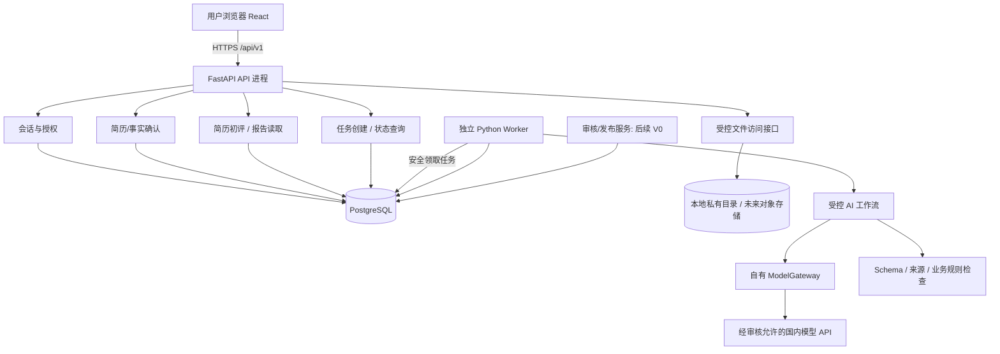
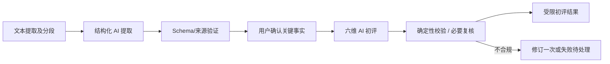

# 知程 AI｜系统架构与技术选型方案 V1.0

> 状态：架构设计基线（待产品负责人最终批准后交由 Codex 实施）  
> 日期：2026-10-14  
> 产品需求唯一依据：`PRD-v1.1.md`（版本 1.1.0，2026-10-08）  
> 本文目标：让一人团队以可控成本快速构建有效的 AI 简历反馈闭环，并在不推倒重来的前提下逐步实现 PRD 正式 V0、V1 与后续 Agent 质量审核。  
> **范围声明**：本文是系统技术设计，不代替 PRD，不代表实际代码、部署、专家校准或合规审查已经完成。

## 目录

1. [执行摘要及决策状态](#1-执行摘要及决策状态)
2. [产品约束、范围分期与成功标准](#2-产品约束范围分期与成功标准)
3. [总体架构与数据流](#3-总体架构与数据流)
4. [前端架构与既有 UI 迁移](#4-前端架构与既有-ui-迁移)
5. [后端模块边界与依赖约束](#5-后端模块边界与依赖约束)
6. [AI Agent、工作流和模型网关](#6-ai-agent工作流和模型网关)
7. [PostgreSQL、快照与任务持久化](#7-postgresql快照与任务持久化)
8. [API 契约、状态与错误恢复](#8-api-契约状态与错误恢复)
9. [安全隐私、审核与报告发布门禁](#9-安全隐私审核与报告发布门禁)
10. [本机开发、测试、部署及未来扩容](#10-本机开发测试部署及未来扩容)
11. [工程规范、测试与 Codex 工作流](#11-工程规范测试与-codex-工作流)
12. [首批垂直切片与任务拆解](#12-首批垂直切片与任务拆解)
13. [关键权衡、风险与演进条件](#13-关键权衡风险与演进条件)
14. [待确认事项与正式采纳清单](#14-待确认事项与正式采纳清单)
15. [PRD 需求追踪与引用](#15-prd-需求追踪与引用)

---

## 1. 执行摘要及决策状态

### 1.1 推荐架构

**React + TypeScript + Vite + Tailwind CSS + shadcn/ui → FastAPI 模块化单体 → 独立 Python Worker/受控 AI 工作流 → PostgreSQL + 私有文件存储 → 国内模型 API。**

- **核心架构**：单代码仓库（Monorepo）、模块化单体（非微服务）；API 与 Worker 使用同一 Python 业务代码库，但独立进程运行。
- **AI 目标**：长期支持“全流程 Agent 质量审核”；近期采用确定性规则 + 受控模型调用，PRD V0 正式报告**仍须人工审批**。自动审核/发布须经过影子评估、专家校准、权限与产品规则再次批准。
- **多模型**：业务只依赖自有 `ModelGateway` 契约；初期只配置 1 个可用的境内模型及必要时的第 2 个候选模型。不使用 OpenAI API；供应商适配层不以任何单一厂商 SDK 为业务依赖。
- **数据**：PostgreSQL 管理权限、事实版本、评估证据、任务和报告；原始简历走私有文件存储抽象。开发阶段可用本地私有目录，生产阶段可选国内 OSS/COS。
- **任务**：长耗时 AI 调用由 Worker 处理，持久化状态与幂等约束第一批即建立；第一批不强制 Redis、Celery、LangGraph、Kubernetes。
- **开发方式**：本机先跑通真实业务价值闭环；现有 UI 先审查后迁移；本地按影响范围检查，**暂不上 GitHub CI**；后续上线前再建立必要发布门禁。

### 1.2 决策分级

| 项目 | 目前状态 | 说明 |
|---|---|---|
| 前端 React/TS/Vite/Tailwind + shadcn/ui | 已讨论倾向 | 以既有 UI 审查结果决定迁移量；不无条件重写 |
| 后端 FastAPI、Python | 已讨论倾向 | 不选 Django 主要是该项目未来偏向 AI 工作流而非传统 Admin 驱动 |
| PostgreSQL + SQLAlchemy 2.x + Alembic | 已讨论倾向 | 版本在实施前执行实际兼容性检查 |
| API/Worker 独立进程、模块化单体 | 已讨论倾向 | 不等于微服务 |
| 自有 Gateway + 国内模型 | 已确认方向 | **不使用 OpenAI API**；具体供应商/模型尚未确认 |
| Agent 全流程质量审核 | 长期目标 | 不能覆盖当前 V0 人工审批要求 |
| 首批只做简历反馈垂直切片 | 已确认 | 内部验证，**不冒充 PRD V0 试点上线** |
| 本机先开发、后上中国大陆云 | 已确认方向 | 云厂商、机型、实例与预算待定 |
| GitHub CI 暂缓 | 已确认方向 | 本地必要验证仍要保留 |
| 队列具体库、API 字段、数据库 DDL | 待技术验证 | 下文为候选契约，不是已锁定实现 |

## 2. 产品约束、范围分期与成功标准

### 2.1 PRD 不可违反的事实

源自 PRD v1.1：

- 用户群：国内计算机相关专业的大三/大四，技术实习和初级校招；首批岗位原型为 MCU 软件、Linux 用户态 C、C++ 应用开发实习。
- `SkillClaim` 不能等同于已验证能力；未测/证据不足不等于能力差；`assessed_level=null` 必须连同 `performance_state` 解读。
- 简历质量、候选人真实能力和岗位准备度是独立领域；V0 简历初评是**六维文字评价**，不可出现 0–100 综合分。
- V0 答题后只能先展示提交/待审核状态；**正式技术等级、关键短板、项目个人贡献增强、局部 Gap/Coach 最终结论**必须人工审批且与内容版本绑定。
- V0 会话短留存、隔离、撤销和删除；具体保留期限属于待批准参数，而非法定固定天数。
- PRD 的 V0 包含 6–10 题试验范围快速诊断、局部报告及人工复核；题数、题型比例、等级门槛均尚待校准。

### 2.2 明确三种交付层级

| 层级 | 内容 | 是否允许对外作为 PRD V0 |
|---|---|---|
| **D0 内部效果验证（首批）** | 简历粘贴/文本 PDF → 结构化理解 → 用户确认 → 六维非数值初评与问题定位；可生成供内部核验的改写候选 | **否**。正式项目事实增强未经审核不得当作发布内容 |
| **V0 PRD 封闭验证** | 增加岗位/JD、6–10 题问答、技能证据、局部 Gap/Coach、**人工审核发布门禁**及隐私治理 | 需满足 PRD §6.0、§19–20 准入条件 |
| **V1/V1.1 及后续** | 正式账号、历史、复测、成长增强；待批准后逐步引入 Agent 影子审核和条件自动化 | 需新产品决策和质量准入 |

**D0 最低效果验收**：经授权测试简历至少能获得来源可定位、事实不虚构、优先级明确、修改方式可执行的反馈；模型失败后输入不丢失，成本可测。该目标是验收标准，不是现有产品效果陈述。

## 3. 总体架构与数据流



**物理部署 vs 逻辑职责**：API 与 Worker 第一批可以运行在同一台本机/云服务器，使用两个独立进程；不同模块不需要不同机器。Agent 是后端能力，不运行在用户浏览器中。浏览器不得持有模型密钥、直接访问数据库或直接调用模型供应商。

### 3.1 D0 业务时序

1. 前端创建临时会话，获得受保护的访问凭据；服务器保存令牌摘要。
2. 提交粘贴文本或文本 PDF；验证 MIME/大小/页数与可解析性，并存储原文/位置索引。
3. Worker 执行结构化提取；Pydantic/来源校验后保存**候选**解析结果。
4. 用户只需确认影响判断的关键事实，特别是**本人贡献、成果数字及其他 AI 不确定项**；系统建立不可静默改写的确认快照。
5. Worker 基于已确认快照执行六维简历初评；若没有岗位，岗位针对性为 `not_applicable`；纯文本版式无法观察时为 `unknown`。
6. 规则/必要的 AI 质检拦截无来源断言、非法状态和虚构数字；可读初评与有事实依据的修改方向交给前端。
7. 项目贡献增强等正式 V0 需审批内容在 D0 只能作为内部草稿展示给授权测试者，不能包装为已批准对外报告。
8. 撤销/过期/删除让访问立即失效，并触发数据库、文件及关联任务的受控清理。

## 4. 前端架构与既有 UI 迁移

### 4.1 前端选型

| 层 | 建议 | 采用原则 |
|---|---|---|
| 框架 | React + TypeScript + Vite | 首先审查已有工程。符合则原地完善，不重复搭建 |
| 样式 | Tailwind CSS + 统一设计 Token | 保留既有视觉成果 |
| 基础组件 | shadcn/ui + 必要的自定义组件 | 不强制全部替换现有组件 |
| 路由 | React Router（候选） | 有多页面/流程需求时采用 |
| 服务端数据 | 简单 fetch + typed API Client 起步 | 缓存复杂后再考虑 TanStack Query |
| 客户端状态 | React 本地/Context 起步 | 有跨页面复杂状态再考虑 Zustand |
| 接口契约 | FastAPI OpenAPI → 生成或校验 TS 类型 | 前后端禁止各自手写冲突枚举 |
| 测试 | TypeScript、ESLint、必要的 Playwright | 以关键交互而非盲目覆盖率为准 |

### 4.2 现有网页 AI 项目迁移要求

**先审查，后迁移，最后验收**：核对 `package.json`、构建方案、路由、UI 库、组件、页面和 Mock；逐页面映射 PRD UI-01～UI-11 及 D0/V0/V1 阶段。确认视觉基线后，最大限度保留页面布局、颜色、动效、响应式、素材与交互；不无故清空原工程。未确认当前工程是什么技术栈时，不声称迁移已经必要或已完成。

前端真实状态需标记 `REAL`（真实前端交互）、`MOCK`、`PLACEHOLDER`、`BACKEND_REQUIRED` 和 `BROKEN`；不可把 Mock 假扮真实后端能力。向用户展示审核状态和报告内容的最终授权由服务端决定。

## 5. 后端模块边界与依赖约束

按**业务领域**分包，避免大型全局 services/models 文件夹；共享基础库只承载跨域技术能力。

| 模块 | D0 内容 | 未来扩展 | 禁止越权 |
|---|---|---|---|
| `session` | 临时会话、访问控制、撤销/过期 | V1 账号与历史档案 | 不能做技术能力判断 |
| `resume` | 输入、解析草稿、来源锚点、事实确认快照 | 多版本简历/复杂解析 | 不能把自述技能授级 |
| `resume_review` | 六维文字初评、可追踪问题、内部改写草稿 | 审核后的正式文字增强 | 不得直接发布正式技术结论 |
| `jobs` | 持久任务、状态、幂等、重试、Worker 租约 | 队列扩容与不同任务优先级 | 不得无约束重试 |
| `model_gateway` | 供应商 Adapter、路由、配额、元数据 | 多模型切换、成本/质量路由 | 不直接写业务 SkillState |
| `role_jd` | D0 不实现 | 3 岗位原型、JD、版本与事实确认 | 不能修改能力证据 |
| `assessment` | D0 不实现 | Rubric、题目、回答、证据和授级 | Agent 输出不能自行授级 |
| `gap_coach` | D0 不实现 | Gap、DEFER、计划、复测 | 不能修改已确认能力历史 |
| `reports` | 初评结果读取 | 正式报告快照、审计与访问 | 不得绕过审核 |
| `publication_review` | D0 不实现正式发布 | V0 人工审批及后续 Agent 影子审核 | 不能把草稿视为已批准版本 |

**依赖纪律**：模块对外提供 service/contract；禁止跨模块直接更改别人的数据表。领域逻辑不依赖具体 HTTP 请求、供应商 SDK、前端组件或 Worker 调度实现。

## 6. AI Agent、工作流和模型网关

### 6.1 第一批固定工作流



- `Orchestrator` 由普通 Python 状态机与任务服务实现，**第一批不需要 LangGraph**。
- AI 负责理解、初评、提出修改候选；规则负责状态转换、字段校验、原文引用存在性、幂等、访问权限、预算、版本检查。
- 引用存在性只能证明引用指向原文，不能单独证明 AI 的语义判断正确；重要技术判断必须使用审校样本和人工/独立模型评估。
- 用户确认是明确的人机交互步骤，不是长期运行的 Agent。
- 动态循环有限次（重试/修订/费用预算）；超限失败或待人工处理，不产生未经验证的确定性结论。

### 6.2 统一 ModelGateway

业务接口示意（非最终 Python 签名）：

```python
result = await gateway.generate_structured(
    task="resume_review",
    payload=prepared_minimal_context,
    output_schema=ResumeReviewOutput,
    policy="resume_review_default",
)
```

**必须抽象的能力**：`task`、模型能力配置、超时、Token/调用预算、结构化输出验证、错误分类、适当重试、模型/Prompt/Schema 版本、用量与费用记录、数据地域/授权限制。

- 第一批先接入**一个经实际测试可用的国内模型**；另一个适配器可通过测试替身检验接口扩展性，不强制付费接入两个供应商。
- **不使用 OpenAI API**。可以研究通用兼容协议，但不应让上游“兼容 OpenAI”变成业务层必须依赖 OpenAI SDK 的理由。
- LiteLLM 等第三方路由库只能作为**候选实现细节**。若增加不必要依赖，优先使用自有轻量 Adapter；不默认部署独立 LiteLLM Proxy。
- 不依据价格或宣传直接认定模型擅长 C/C++、MCU、Linux；必要时通过后续 Rubric 和技术评测集决定是否允许进入正式评分环节。
- 不得把原始简历在主供应商失败后未经授权自动跨地域/跨供应商转发。

### 6.3 长期全流程质量审核

目标：问题生成→技术正确性复核→答案证据抽取→状态判断→Gap/Coach→报告内容审核，每个关键节点均有质量门禁。**不是部署一组互相自由讨论且可擅自改数据库的 Agent**。

V0 正式报告只能人工审批；后续可先“Agent 影子审核（不影响发布）”，与专家对照。只有在实际质量基线、合规和产品批准后，才允许明确范围内的自动审核和有条件发布。发布权限始终由后端受控服务持有。

## 7. PostgreSQL、快照与任务持久化

### 7.1 D0 最小实体草案

| 实体 | 主要字段/关联（概念） | 必须满足 |
|---|---|---|
| `sessions` | id、token_hash、consent_version、expires_at、revoked_at | 不记录明文令牌；有过期与隔离 |
| `resumes` | id、session_id、input_type、file_ref、text_hash、created_at | 所有权绑定；原始文件可清理 |
| `resume_snapshots` | id、resume_id、version、source_span_index、claims_json、confirmed_at | 提取草稿与确认事实分开；新确认生成新版本 |
| `resume_reviews` | id、snapshot_id、review_version、dimensions_json、findings_json、visibility_state | 绑定输入快照；未知/不适用状态有效 |
| `ai_jobs` | id、session_id、type、status、idempotency_key、lease_until、attempts、result_ref | 防重复、崩溃恢复、取消后不提交过时结果 |
| `ai_call_records` | id、job_id、provider、model、prompt/schema_version、tokens、latency、error_class | 脱敏元数据、费用可追踪 |

根据事务/索引/授权实际需要可增加辅助表，**不要求必须恰好六张表**。外键、唯一键、角色归属、数据清理和事务边界必须在实施时落实。

### 7.2 存储策略

- 高频检索与强约束属性采用关系列；候选提取和报告结构可采用经 Schema 验证的 `JSONB`。
- 不把完整简历、模型原始上下文、API Key 写进普通日志或调用统计表。
- 原始 PDF 存放在**私有文件存储**；PostgreSQL 只保存必要关联与元数据。首批本机私有目录，未来封装 `FileStore` 适配 OSS/COS。
- 用户确认事实、岗位与报告分别持有版本标识；旧版本不可被新内容偷偷替换。但个人资料删除仍优先于业务历史保留。
- 使用 SQLAlchemy ORM + Alembic 管理迁移，生成迁移必须审阅；不得在真实数据环境自动执行破坏性迁移。

### 7.3 任务可靠性最低要求

`queued → running → succeeded | failed | cancelled`，必要时附加 `retry_wait`；Worker 通过数据库原子领取/租约避免多个进程重复认领。崩溃后通过超时租约重新领取；业务结果写入采用稳定幂等键 + 数据库约束；已经撤销/过期的会话不得再写入对用户可见的结果。

第一批可研究 PostgreSQL 持久队列或自建**非常有限**的 DB job 机制；采用具体库前须实际验证任务租约、事务、重试和并发。系统复杂到需要专用队列时，再评估 Redis/Celery 等组件。

## 8. API 契约、状态与错误恢复

### 8.1 D0 HTTP API 候选

| 方法/路径（候选） | 含义 | 响应形式 |
|---|---|---|
| `POST /api/v1/sessions` | 创建受控临时会话 | session 信息及安全会话凭据 |
| `POST /api/v1/resumes` | 粘贴文本或上传文本 PDF | resume id、解析任务 id |
| `GET /api/v1/resumes/{id}` | 查看提取草稿与来源索引 | 本会话可见候选内容 |
| `POST /api/v1/resumes/{id}/confirm` | 确认/修正关键事实 | 新确认快照 id/version |
| `POST /api/v1/resume-reviews` | 以确认快照创建初评任务 | job id |
| `GET /api/v1/jobs/{id}` | 轮询任务状态与失败类型 | queued/running/succeeded/failed/cancelled |
| `GET /api/v1/resume-reviews/{id}` | 读取有权查看的初评 | 六维结构化结果、来源引用 |
| `DELETE /api/v1/sessions/current/data` | 请求清理当前资料及撤销访问 | 接收/执行状态及清理范围 |

正式技术问答、审核/发布、Gap API 后续设计，不在 D0 假装已经确定。OpenAPI 是前后端契约权威来源；TypeScript 类型应从 OpenAPI 生成或自动校验；API 版本与 DTO 版本区分管理。

### 8.2 前端交互状态

- **上传**：idle / uploading / parsing / parsed / failed / unsupported。
- **用户确认**：draft / requires_confirmation / confirmed / superseded。
- **任务**：queued / running / succeeded / failed / cancelled；显示真实状态，不伪造精确百分比。
- **报告**：D0 受限初评只呈现允许字段；V0 正式报告需与审核/发布状态绑定，绝不靠前端隐藏路由实现访问控制。
- 首批轮询任务状态即可，支持取消轮询、超时提示、返回后重新查询；确有需要时才引入 SSE/WebSocket。

### 8.3 关键错误处理

- 上传异常：类型/文件大小/空文件/扫描型 PDF，返回明确错误并允许文本粘贴或人工补录。
- 模型异常：超时、限流、供应商不可用、响应无法通过 Schema 或业务规则；限次重试，不应伪造成功内容。
- 用户变更事实：生成新版快照，旧任务结果不得覆盖新版结果；必要时取消/标记过期任务。
- 重复请求：同一幂等键返回已存在任务/结果，不得重复生成证据或计费任务（实际已发生的供应商计费仍记录）。
- 越权：任何资源读取/修改都经过服务端会话归属授权；客户端 id 不是授权凭据。

## 9. 安全隐私、审核与报告发布门禁

### 9.1 首批必须有的安全底线

1. 原始简历和用户回答均当作**不可信数据**，不能变成系统指令；严禁执行附件脚本/上传代码。
2. 文件类型、大小、页数、解析超时及资源限制需配置并测试；阈值在实现阶段提出建议，经审查确定。
3. 模型调用最小化个人数据，剔除不需要的联系方式；模型服务地域、日志留存、训练用途、删除能力须逐供应商审查。脱敏不能等同于完全匿名化。
4. 会话与文件授权隔离；令牌不可预测、服务端只存哈希/摘要并设置过期；报告不能通过对象直链绕过授权。
5. 私密数据不默认进入日志、错误跟踪和 CI；本机真实测试简历也要经授权并受控保存。
6. 删除先撤销访问，再执行关联数据库、文件、任务和供应商/备份核查；不能在实际未完成前声称已彻底删除。

### 9.2 V0 正式报告发布不变量

依 PRD v1.1 §19：

- `review_status`: `draft_ai / pending_human_review / needs_revision / rejected / approved / published`。
- `approved` **不等于** `published`；`published` 必须绑定人工审核记录、审核人、版本、`report_hash`（或语义一致且经审批的摘要字段）。
- 修改事实、等级、Gap、报告内容后必须重审；撤销/删除立即阻断旧可见性。
- 报告 API、缓存、对象存储直链均必须执行服务端可见性门禁，不能仅在页面层隐藏。
- 未来 Agent 审核不改变 V0 已批准要求；自动发布须另行产品审批与技术验证。

### 9.3 未来领域状态不可混淆

后续 Assessment 按 PRD `assessment_status`、`performance_state`、`assessed_level` 三个独立轴表示；`assessed_level=null` 不代表较弱；`demonstrated_below_L1` 需要独立有效基础证据交叉验证及人工审核。SkillClaim 永不直接升级为 UserSkillState。

## 10. 本机开发、测试、部署及未来扩容

### 10.1 三环境策略

| 环境 | 时点 | 数据和配置 |
|---|---|---|
| `dev` | 立即 | 本机热更新；PostgreSQL Docker；专用低额度模型 Key；合成或经授权测试资料 |
| `test/staging` | 开发阶段本机隔离、上线前迁云 | 独立数据库、密钥、存储；使用相同源码/迁移/构建产物做完整流程验证 |
| `production` | V0 上线条件满足后 | 中国大陆部署；独立生产数据库和对象存储；受控变更、备份恢复、监控告警 |

推荐日常 React/Vite 与 FastAPI/Worker 本机进程热更新，PostgreSQL 容器化；发布验证使用 Docker Compose 模拟 Nginx + API + Worker + DB。开发机器未具备 Docker 时可暂用独立本机 PostgreSQL，但必须记录差异并补做容器验证。

### 10.2 生产候选

- 云主机运行 Nginx + FastAPI + Worker（小规模时同机不同容器）；PostgreSQL 优先托管；对象存储使用境内私有 Bucket；AI 推理走经确认的境内供应商及地域。
- 不购买 GPU 服务器作为首期默认；不部署 Kubernetes；资源规格与报价需要按实际上云时的流量、内存峰值、数据库备份及厂商计费重新核实。
- 先监控 API P95、Worker 队列等待时间、模型失败/限流、PDF 解析峰值内存、数据库连接与慢查询、单份有效报告成本，再决定分离 Worker、升级数据库或增加缓存。
- 备案、生成式 AI 应用适用义务、个人信息处理、跨境流动与供应商合同需在运营主体和具体部署明确后核查；本文不是法律合规结论。

### 10.3 成本控制

分为固定（主机、数据库、存储、备份、监控）与可变（模型 Token、重试、流量、人工审核）成本。每次 AI 任务记录实际 model、input/output tokens、供应商用量、延迟和调用失败原因；**有效报告单位成本**应计入失败与审核调用。第一批限制请求预算、输出长度、重试次数和每日总调用额度；不得让生成 Agent 与审核 Agent 无限互相重做。

## 11. 工程规范、测试与 Codex 工作流

### 11.1 代码组织（建议，不要求创建全部空模块）

```text
career-ai/
  frontend/            # 当前已有 UI 审查后迁移/复用
  backend/
    app/
      api/             # HTTP 请求、DTO、权限依赖
      modules/         # session/resume/resume_review/jobs 等领域模块
      ai/              # workflow、gateway、adapters、validation
      infrastructure/  # DB、文件接口、基础配置
    worker/            # 与 API 复用业务代码的任务入口
    migrations/        # Alembic
    tests/
  infra/               # Compose、部署配置和环境示例
  scripts/             # 可重复的本机启动/验收脚本
  docs/                # 仅放已批准需求、架构、API 与 ADR
  AGENTS.md            # Codex 项目级执行规则（批准开发后创建）
```

依赖建议：Python 使用 `uv` + `pyproject.toml`/锁文件，前端 `npm` + `package-lock.json`；Ruff、mypy、pytest、ESLint、TS 类型检查。具体工具版本以兼容性测试和实际 lock 文件为准。

### 11.2 Codex 任务执行协议

对每个经授权任务执行：

1. 只读取相关 PRD 段落、当前代码、对应模块契约与关联测试；检查现有实现和可能冲突。
2. 提交边界、影响分析、依赖变化、数据库变化与可测试验收标准；超出授权范围需先征得同意。
3. 修改最小必要文件，优先复用；不得无理由重写已有 UI、升级关键依赖、建立新服务、删除大批文件。
4. 执行**受影响模块的本地类型/静态/单元/接口检查**；关键闭环节点额外执行实际浏览器/真实模型验收（真实模型调用须受配额和隐私限制）。
5. 报告修改文件、实际执行命令及结果、未运行的检查、成本、风险、遗留任务；未通过则不得声称 Done。
6. 高风险变更（正式规则、真实数据访问、破坏性迁移、公开发布、密钥/地域策略）必须人工批准。

**暂不上 GitHub Actions CI**。不强制每次代码修改跑全量检查；每个阶段边界至少执行全局构建/类型和主要业务回归。Git 提交与回滚基线仍应有，不等于必须执行云端流水线。

### 11.3 基础验收类型

- **静态**：Ruff/mypy、ESLint/TypeScript、前端构建。
- **单元**：会话撤销、来源关联、未知维度、事实约束、任务幂等。
- **集成**：PostgreSQL 迁移/事务、文件权限、模拟模型输出、Worker 重试及恢复。
- **端到端**：输入简历→候选提取→纠正事实→AI 初评→实际查看；断网、失败与重试路径。
- **模型质量**：经人工核对的正确/错误项目描述、虚构成果、模糊贡献、纯文本排版 unknown、模型假指令样本。模型输出符合 JSON ≠ 专业分析质量合格。
- **正式 V0 追加**：PRD V11-01～V11-17 等审核、覆盖率、版本、越权和删除回归。

## 12. 首批垂直切片与任务拆解

> 任务编号 `D0-T01`～`D0-T08` 为本架构新建议，不引用任何旧项目的历史任务或代码。**未授权 Codex 开始执行**。

| ID | 交付能力 | 前置依赖 | 必须验收 |
|---|---|---|---|
| D0-T01 | 最小工程、配置、DB/Worker 入口、健康接口 | 无 | React/FastAPI/DB/Worker 在本机可独立运行；锁文件可重现 |
| D0-T02 | 临时会话及访问隔离 | T01 | 不同会话不可越权；撤销立即阻断访问 |
| D0-T03 | 文本粘贴/PDF 输入、可靠提取、来源锚点 | T02 | 成功解析；不支持/扫描 PDF 可明确降级 |
| D0-T04 | 国内模型 Adapter/Gateway、结构化校验、用量记录 | T01 | 实际调用成功；模拟调用零 API 消耗；预算与报错可控 |
| D0-T05 | AI 候选事实 + 用户关键确认 + 快照 | T03/T04 | 否认的贡献不进入确认事实；保留来源 |
| D0-T06 | 持久任务、租约/重试、幂等、结果关联 | T01/T02 | Worker 重启可安全恢复；重复请求不重复写结果 |
| D0-T07 | 六维初评、证据定位、保守改写候选、质量门禁 | T05/T06 | 纯文本排版 unknown；不输出虚构数字、官方等级、综合分 |
| D0-T08 | 现有 UI 复用迁移、API 联调、错误状态、闭环验收 | T02～T07 | 真实浏览器操作完一条流程，测试证据与已知问题清楚 |

建议 **T01 之后尽快做 T04 最小真实模型调用和 T03 真实文件解析**，提前检验最核心风险；T05、T07 均需做实际效果验收，不要等 T08 才发现分析质量不足。T06 的可靠性能力应先以最小、可证实的实现满足 D0，而不是提前建设通用调度平台。

### 12.1 第一个演示案例及退出准则

输入一份本人授权测试的真实技术简历，至少得到：

- 识别技术技能、代表项目及原文片段；有不确定项标记。
- 用户可以纠正本人负责的模块、验证结果或量化事实。
- 六维文字初评逐项区分 `clear / needs_improvement / unknown / not_applicable`，其中评价附具体来源。
- 输出最多三个优先问题、具体修改动作和可复制**候选**文本（无法确认的事实明确留占位）。
- 实际显示任务进度/失败和重试；保存关联版本、调用模型与用量。
- 严格不展示技术等级、获面概率、无法推断的版式问题或未经审核的正式 V0 结果。

## 13. 关键权衡、风险与演进条件

| 取舍 | 当前选择 | 何时重议 |
|---|---|---|
| FastAPI 而非 Django | 更自由地组织 AI/Worker 业务；后台自行实现最小审核界面 | 传统内管需求明显增长且自建后台成本偏高 |
| 模块化单体而非微服务 | 少服务、少部署、事务直接 | 明确独立扩容、安全隔离、团队组织要求时 |
| 固定工作流而非多 Agent 编排框架 | D0 状态可控且调试成本低 | 并行任务、复杂追问、跨天恢复等显著增加时 |
| PostgreSQL 任务队列而非 Redis/Celery | 减少初期基础设施 | 真实队列延迟、并发和可靠性达到瓶颈时 |
| 国内模型 + 自有 Gateway | 可换供应商但限制数据跨境风险 | 经真实模型效果、条款和费用评估再增配 |
| 本地 CI 替代 GitHub CI | 不因远程流程拖慢高频迭代 | 多开发者协作、准备公开上线、发布风险升高时 |
| D0 先简历价值验证 | 避免实现全套基础设施后才检验价值 | D0 体验与事实约束达标后进入完整 V0 |

**重点风险**：AI 文本分析“看起来专业但不真实”；结构化输出兼容与跨供应商差异；文本 PDF 来源定位不准确；用户纠正导致旧结果过期；后台长任务丢失/重复；会话和文件越权；仅用前端控制正式报告；未经批准自动公开结果。必须在对应阶段建立阻断测试。

## 14. 待确认事项与正式采纳清单

在授权 Codex 开发前，需至少确认：

1. **现有 UI 技术现状**：项目实际框架、是否已是 React+TS+Vite、已有页面与 Mock 程度；决定保留与迁移范围。
2. **本机环境**：操作系统、Node/Python/PostgreSQL/Docker 现状、是否可运行 Worker；给出实际版本兼容清单。
3. **国内模型**：供应商、具体模型、API 地域、合同/隐私/留存条款、结构化输出和价格；敏感信息的测试边界。
4. **D0 文件阈值**：PDF 大小、页数、扫描件处理策略与临时文件清理。
5. **用户确认和初评体验**：关键事实确认粒度、展示哪些内部候选改写，如何避免与 V0 正式审核混淆。
6. **本机数据处理**：是否使用经授权的真实简历、清理时间、访问和备份方式。
7. **任务实现**：评估实际 DB 队列库或有限自建方案的租约/重试能力；不得只凭架构图宣称可靠。
8. **上云时的事项**：运营主体、云区域、备案与隐私义务、生产密钥/备份/恢复策略；目前不需要采购。

正式批准后，下一批可生成并版本化：`api-contract.md`、`data-model.md`、`ai-workflow-contract.md`、`implementation-plan.md`、`AGENTS.md` 等。**本次仅交付系统架构方案，不提前创建这些实施文件，也不创建工程或代码。**

## 15. PRD 需求追踪与引用

本方案基于用户提供的 `PRD-v1.1.md`，主要映射如下；**以下为文件内章节指引，不代表配套规范已经上传或通过验收**。

| 架构部分 | PRD v1.1 对应章节 |
|---|---|
| D0 目标、三岗位、不可承诺事项 | §1、§3、§6.0、§15 |
| 六维初评、项目事实、改写限制 | §7、§19.5–§19.6 |
| 技术问答及证据、独立状态轴 | §8、§11、§19.2–§19.3 |
| JD/岗位模型与 Gap | §9、§10、§19.4 |
| 数据快照、幂等、证据来源 | §11 |
| 数据隐私、可信输入、发布安全 | §12、§19.1、§19.5 |
| 场景验收与质量门槛 | §13、§19.6、§20 |
| 待拍板问题与研发拆解 | §16、§17、§20 |

**文档使用原则**：产品行为与发布门槛以 PRD v1.1 为准；本文补充“如何实现”的设计建议。若出现矛盾，停止该项实现并提请产品负责人裁决，不得由 Codex 静默改写 PRD。技术选型是阶段性架构选择，不是声称已经完成依赖兼容、压测、法律或模型质量验证。
